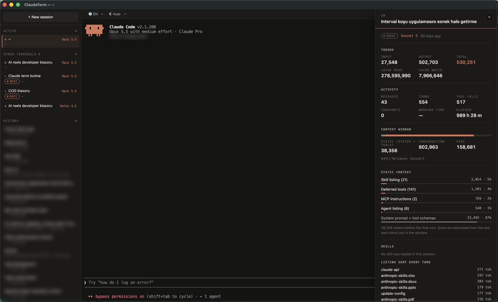
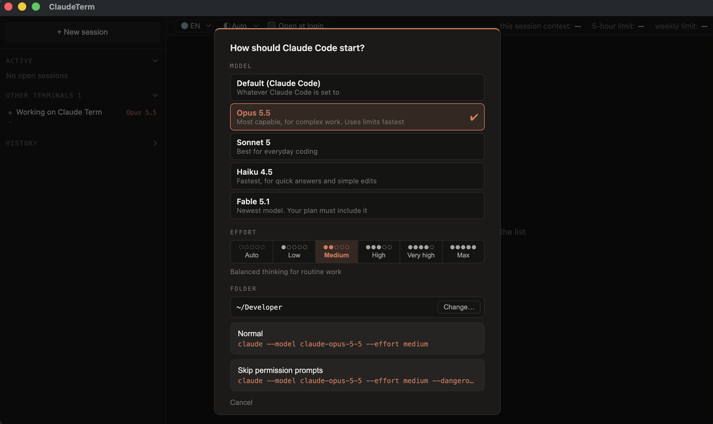

# ClaudeTerm

[](./LICENSE)


**Get more out of every Claude Code session.** A macOS terminal that opens straight into [Claude Code](https://claude.com/claude-code) and keeps your sessions, your context and your limits in view.



Run Claude Code in four terminals and you lose track of which one is waiting on you, which is still working, and how much of your five-hour window is left. Claude Code already writes all of that to `~/.claude`. ClaudeTerm reads it — nothing else — and puts it next to the terminal you are typing in.

## What you get

- ✅ **Every session in one sidebar** — open ones on top, past ones below. Click a past one to resume it in its original folder.
- ✅ **The model and status of each session** — `Opus 5.5`, `Sonnet 5`, `Haiku 4.5` in orange beside the title, and whether it is busy, waiting for you, or idle.
- ✅ **Sessions from other terminals** — Claude Code running in iTerm, VS Code or anywhere else shows up under *Other terminals*, with the same status.
- ✅ **A detail panel per session** (ⓘ) — tokens, messages, tool calls, subagents, working time, and how full the context window is. [More](#session-details)
- ✅ **Where the standing context goes** — which `CLAUDE.md`, the MCP instructions, the tool and agent listings, and **tokens per skill**: the skills loaded in the session and each skill's share of the listing sent on every turn.
- ✅ **Your limits** — this session's context, the five-hour window and the weekly window (used, remaining, reset time) in the status bar. Amber at 70%, red at 90%.
- ✅ **Model, effort and folder on launch** — pick the model the way Claude Code's `/model` shows it, effort from auto to max, and the folder to start in; each button shows the exact `claude` command it runs. The last choices are remembered. [See it](#starting-a-session)
- ✅ **Light and dark** — follows macOS, or pick one. The terminal follows too.
- ✅ **Open at login** — one checkbox in the status bar starts ClaudeTerm when you log in (in the built app; `npm start` leaves it off).
- ✅ **Several sessions in one window**, renameable — including ones running in other terminals (double-click a title) — GPU-rendered (WebGL) for fast scrolling.
- ✅ **English, German, Turkish and Spanish** — English by default, switchable from 🌐; the choice is remembered.
- ✅ **No changes to your Claude Code setup**, no telemetry, no network calls of its own. [More](#privacy)

## Build it yourself

No prebuilt binaries — clone and build on your own Mac. A locally built app isn't quarantined, so macOS opens it without the Gatekeeper warning.

Requirements: macOS, Node.js 20+, Xcode Command Line Tools, and Claude Code installed and logged in.

```sh
git clone https://github.com/eyupcimen/claude-term.git
cd claude-term
npm install
npx electron-rebuild
npm start          # run it
```

To install it like any other app, build the `.app` and copy it to Applications:

```sh
npx electron-builder --mac dir
cp -R dist/mac-arm64/ClaudeTerm.app /Applications/    # Intel Macs: dist/mac/
```

Then open it from Spotlight (⌘ Space → ClaudeTerm). `npm run dist` builds a `.dmg` instead.

Or open the folder in Claude Code and ask: *"build and run this app"*.

## Starting a session

**+ New session** asks how Claude Code should start: the model, the effort level, and the folder. Each button shows the exact command it will run, so nothing is hidden. Resuming a session from *History* opens the same dialog, in that session's own folder.



## Session details

Hover any session and click **ⓘ** — open, from another terminal, or from history. The panel slides in from the right; **Esc** closes it. While the session is running it refreshes every few seconds.

| Section | What it shows |
| --- | --- |
| Tokens | Input, output, total, cache read and cache write, summed over every turn |
| Activity | Your messages, Claude's turns, tool calls, subagents, working time, and elapsed time without idle gaps |
| Context window | How much of the model's window the last turn used: the static block, the conversation, and what is free |
| Static context | What the window holds before you type anything — each `CLAUDE.md`, the skill listing, deferred tools, agents, MCP instructions, and the system prompt and built-in tool schemas |
| Skills | Skills loaded during the session with their token cost, and each skill's line in the listing every turn carries |
| Tools | Tool calls by name |
| Resume | A copyable `claude --resume <id>` |

The static block is measured from the first turn. The named rows are estimated from the text each block put in the window (four characters to a token); whatever they don't account for is the system prompt and tool schemas, which are never written to disk.

## Keyboard and mouse

| Key | Does |
| --- | --- |
| <kbd>Esc</kbd> | Close the detail panel |
| Double-click a title | Rename the session |
| <kbd>↵</kbd> / <kbd>Esc</kbd> while renaming | Save / cancel (an empty name restores the automatic title) |
| <kbd>⌘</kbd> <kbd>Q</kbd> | Quit — waits for every session to exit cleanly |

## Privacy

Read-only, local, and no telemetry.

- **Limits and context** come from Claude Code's own status line feed. ClaudeTerm passes its status line command in per window with `--settings`; your `~/.claude/settings.json` is not modified.
- **Running sessions** are read from `~/.claude/sessions/*.json`, each checked against a real process so a stale file or a recycled PID never shows up as running.
- **Session details and history** are read from the transcripts in `~/.claude/projects/`.
- **What it writes:** only its own app data — the status line settings file, one small status file per open session (deleted when it closes), and your chosen titles, language, theme, model and effort. *Open at login* adds ClaudeTerm to macOS Login Items, and unticking it removes it.
- **Network:** none. ClaudeTerm makes no requests of its own; Claude Code talks to Anthropic as it always does.

## FAQ

**Does it change my Claude Code settings?**
No. The status line it needs is passed per window with `--settings`, so your own settings and status line stay as they are.

**Why are the limits empty at first?**
Claude Code sends them with its first status line update after a reply. Ask anything and they appear.

**Are the per-skill token counts exact?**
They are estimates from the text, at four characters to a token, scaled to fit the static block that was actually billed. Good for seeing which skills are heavy, not for accounting.

**Can I attach to a session from another terminal?**
No — it is shown and inspectable, but its terminal belongs to the other app. Once it ends it moves to *History*, where you can resume it here.

**Why does macOS ask for access to Desktop, Documents or Downloads?**
Claude Code indexes the folder it starts in. Started in your home folder, that reaches every protected folder at once, so new sessions start in `~/Developer` (or the folder you pick) instead; macOS then only asks when a session actually works there. Each rebuild of the app is a new ad-hoc signature, so macOS may ask again after you rebuild.

**Why does Claude Code look washed out in the light theme?**
Claude Code picks its colours for its own theme. Run `/theme` inside Claude Code and choose a light one.

**Why no prebuilt download?**
Without an Apple Developer ID a downloaded app gets the "unidentified developer" warning. Building it yourself avoids that.

**Windows or Linux?**
macOS only for now.

## License

MIT © [@eyupcimen](https://github.com/eyupcimen)
